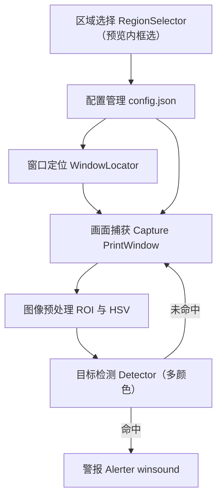

# EVE 端游本地红名预警工具 · 开发文档与技术栈规划

> 一款纯本地、只读截屏、零内存改动的轻量化预警工具：玩家框选游戏界面任意区域，工具在该区域内识别敌对红名，命中即触发本地警报。

| 项目 | 内容 |
| --- | --- |
| 文档版本 | v1.0 |
| 成稿日期 | 2026-08-30 |
| 最近更新 | v1.2.1（2026-11-20）：检测器重写为「方格 + 网格」；v1.2.0（2026-11-20）：无人机增加返回中识别与可配置空闲延时 |
| 目标平台 | Windows 10 / 11 |
| 前置定位 | 纯本地、只读截屏、零内存改动 |

---

## 1. 项目定位与设计原则

在《EVE Online》中，敌对玩家在总览（Overview）与太空视野中以特定颜色名称标识（默认红 / 橙 / 黄，中立为灰白）。本工具的目标是充当一台**「只读屏幕阅读器」**：它只读取操作系统已经渲染到屏幕上的像素，对指定游戏窗口画面做实时捕获，在玩家自定义的监控区域内按所选颜色检测目标，一旦命中立即播放本地警报音。

整个方案被四条不可妥协的设计红线约束，它们决定了后续所有技术选型：

- **只读截屏：** 仅通过操作系统图形接口读取屏幕像素，与 OBS、截图软件同属一类读操作，不触碰游戏进程内存。
- **零内存 / 零注入：** 不使用 ReadProcessMemory、不 OpenProcess 读写、不注入 DLL、不挂 Hook，从机制上规避反作弊风险。
- **完全本地：** 无任何网络请求、无数据上传、无遥测，配置与警报音全部落盘本地。
- **轻量低耗：** 只处理玩家选定的 ROI（Region of Interest），采用低帧率 + 1× 方格/网格判定的高效管线。

> **核心设计决策：** 目标识别不依赖模型推理或模板库，而是先在 1× ROI 中寻找阵营方格的轮廓，再用固定列/行距网格和方格边缘颜色排除背景。这是满足「轻量化 + 低延迟 + 无需训练」的可靠路径：OpenCV 运算集中在很小的图标列 ROI 内，典型单帧耗时约 10–15 ms。

---

## 2. 需求分析

### 2.1 功能需求

| 编号 | 功能 | 说明 |
| --- | --- | --- |
| FR-1 | 游戏窗口实时捕获 | 精准定位并获取指定的 EVE 端游窗口画面，支持窗口化、无边框全屏等常见模式。 |
| FR-2 | 自定义区域选择 | 玩家通过鼠标框选游戏界面中的特定区域作为监控 ROI，坐标以归一化方式保存。 |
| FR-3 | 目标识别 | 在自定义区域内识别玩家名字前的阵营方格，以方格外形、外环/四角颜色和固定网格判断敌对目标（可选红 / 橙 / 黄 / 灰白，默认全选）；不依赖名字与中心图形。 |
| FR-4 | 警报触发 | 检测到目标时立即持续播放预设警报音（按完整周期播放，停止时当前周期自然放完，不截断），目标消失即停止（无冷却）。 |
| FR-5 | 完全本地化 | 不包含任何网络请求或数据上传功能，全程离线运行。 |
| FR-6 | 反作弊安全 | 不修改内存、不注入、不 Hook，仅做只读屏幕捕获。 |

### 2.2 非功能需求

| 类别 | 指标 | 要求 |
| --- | --- | --- |
| 可靠性 | 识别准确率 | ≥ 90%（方格 + 网格检测；验收基于总览样例与实景回放，不以名字识别为前置条件） |
| 可靠性 | 响应延迟 | ≤ 300 ms（目标出现到警报响起，目标 ≤ 100 ms） |
| 兼容性 | 操作系统 | Windows 10 / 11 |
| 兼容性 | 分辨率 / 窗口模式 | 1080p、1440p、4K；窗口化、无边框全屏（独占全屏按可用性自动回退） |
| 资源占用 | CPU / 内存 | 低功耗运行，空闲时 CPU 占用显著低于 1 个逻辑核心 |

---

## 3. 技术栈选型

选型的第一性原则是：**性能瓶颈全部下沉到 C/C++ 库，语言层只做「胶水」**。截屏由 PrintWindow（GDI）与 mss 的 C 实现完成，图像处理由 OpenCV 的 C++ 后端完成，因此即便用 Python 作调度层，逐帧开销也可忽略，却能换来最短的迭代周期。这也是本工具首选 Python 而非 C++/C# 的根本原因。

### 3.1 语言 / 运行时方案对比

| 方案 | 优点 | 缺点 | 结论 |
| --- | --- | --- | --- |
| Python 3.11 + OpenCV | 开发最快、CV 生态最全、易校准调参 | 打包体积偏大（约 50–80 MB） | **首选（MVP）** |
| C# / WPF + OpenCvSharp | 原生 Windows 集成好、二进制小、遮罩 UI 自然 | 开发慢、CV 生态相对弱 | 备选 |
| C++ + DXGI + OpenCV | 性能与体积最优 | 开发成本高、维护难 | 进阶重写 |

### 3.2 最终选型清单

| 层 | 选型 | 选型理由 |
| --- | --- | --- |
| 语言 | Python 3.11+ | 开发快、生态全，性能由底层 C 库承担。 |
| 屏幕捕获 | PrintWindow（窗口内容渲染），mss（BitBlt）兜底 | PrintWindow 直接渲染目标窗口自身画面，被遮挡时也只捕获所选窗口；独占全屏等失效场景回退 mss 屏幕抓取。 |
| 图像处理 | OpenCV + NumPy | 颜色阈值、形态学、轮廓均在 C++ 后端高速执行。 |
| 窗口定位 | pywin32（win32gui） | 按进程名 / 窗口标题枚举并命中目标窗口，读取窗口矩形；含最小化状态检测。 |
| GUI | PySide6 | 控制面板、自动适应预览控件（预览内框选）、目标程序选择对话框。 |
| 音频 | winsound（stdlib） | 按完整周期播放 WAV（周期结束仍警报则自动续播），识别即播直到目标消失；停止不截断、当前周期自然放完；文件缺失回退 Beep。 |
| 配置 | 本地 JSON | 无数据库、无网络，符合完全本地化要求。 |
| 打包 | PyInstaller / Nuitka | 产出免安装 exe；Nuitka 编译后可进一步降低运行开销与启动时间。 |

---

## 4. 系统架构

工具由七个内聚模块组成一条「捕获 → 预处理 → 检测 → 报警」的主链路。区域选择把玩家框选的 ROI 归一化坐标写入配置，捕获模块据此只抓取窗口对应矩形，从而把后续所有计算限制在最小范围。



---

## 5. 模块设计

各模块职责单一、通过配置与内存中的帧数据松耦合，便于单独测试与替换。核心接口与实现要点如下。

| 模块 | 职责 | 关键技术点 |
| --- | --- | --- |
| window_locator | 定位并锁定目标窗口 | EnumWindows 按进程名 / 标题匹配；GetClientRect 与 ClientToScreen 取真实边框；IsIconic 最小化检测。 |
| capture | 按窗口内容抓取画面 | PrintWindow（PW_RENDERFULLCONTENT）直接渲染目标窗口自身画面，被遮挡也只捕获所选窗口；失败回退 mss 屏幕抓取。 |
| region_selector | ROI 坐标归一化换算 | 预览画面内鼠标框选，记录起止点并转为窗口归一化坐标存储；越界自动钳制。 |
| detector | 方格/网格/颜色分类 | 1× 局部灰差、Lab 色差、饱和度、边缘与自适应暗面提取候选；近方形几何筛选；固定 x 列、行距与相位建网；只采样外环/四角分类；同位置 + 同颜色连续帧确认。 |
| colors | 敌友颜色分类 | 红 / 橙 / 黄 / 灰白为敌对预设；蓝 / 绿 / 紫仅作为友军建网色；提供颜色别名与兼容模式阈值。 |
| alerter | 触发警报 | winsound 按完整周期播放（周期结束仍警报则续播），识别到目标即持续警报直到目标消失（无冷却）；停止时当前周期自然放完不截断；缺失回退 Beep。 |
| config | 配置读写 | 本地 JSON 保存窗口标识、ROI、启用颜色与兼容模式等；与默认值深度合并。 |
| logger | 日志记录 | 统一 logging：数据目录 logs/ 滚动文件（打包后 `%APPDATA%\eve-alert\logs`）+ 控制台，级别可配置，覆盖生命周期事件与异常。 |

### 5.1 窗口定位

通过进程名（EVE 客户端进程，如 `exefile.exe`）枚举顶层窗口，命中后读取窗口客户区矩形。注意 Windows 的 DPI 缩放会使逻辑坐标与物理像素不一致，须调用 `SetProcessDpiAwarenessContext(PER_MONITOR_AWARE_V2)`，否则在高 DPI 下捕获位置会偏移，导致 ROI 错位。

### 5.2 区域选择与坐标归一化

框选在**控制面板的预览画面内**通过鼠标拖拽完成（不覆盖被监控程序界面，也不影响其他应用操作）。框选的 ROI 以**窗口内的归一化坐标**（0–1 的 x/y 比例）保存，而非绝对像素。这样玩家切换分辨率或改变窗口尺寸后，监控区域仍自动跟随原位置，无需重新框选。实际抓取时再由当前窗口尺寸换算回像素坐标，框选越出预览边界时自动钳制到可视边缘。

### 5.3 日志与运行诊断

工具内置统一日志（`core/logger.py`），**仅记录异常 / 崩溃**，保持日志简洁，便于事后排查闪退与致命错误：

- **输出**：数据目录 `logs/eve-alert.log` 滚动文件（开发期项目根、打包后 `%APPDATA%\eve-alert`；默认 2MB、保留 3 份）+ 控制台；级别与文件路径可经 `config.json` 的 `logging` 段调整（`level` / `file`），默认 `error`。
- **格式**：`时间 | 级别 | 模块 | 消息`（如 `2026-08-30 00:20:00 | ERROR | panel | ...`）。
- **覆盖事件**：监控线程异常（含 traceback）、未捕获异常导致的闪退（`main.py` 的 `sys.excepthook` 统一钩子）、警报播放失败等 ERROR 及以上事件；普通生命周期事件不记录。
- **级别约定**：默认 `error` 仅记异常；排查问题时可临时调低到 `warning` / `info` / `debug`（`logging.level`），恢复后调回。

---

## 6. 核心算法：方格 + 网格检测

检测单位是玩家名字**前的阵营方格**，不是颜色块或名字条。检测流程在 ROI 的原始分辨率上完成，不依赖名字，也不依赖方格中心的星形、十字、横杆、圆点、六边形或空白图案。


### 6.1 为什么是方格

EVE 总览的玩家条目在名字前固定排列一列阵营方格。格子本身提供比名字更稳定的 UI 结构：名字可换字体、语言和宽度，中心图形可随阵营或皮肤变化，但外框与行列位置由总览布局和字号共同决定。半透明太空背景下可能出现与敌对色相近的行星、红灯或列表块；这些对象通常是圆形、不规则形状或孤立颜色块，不会同时满足方格外框和固定网格关系。因此检测应先确认“这里有一个阵营方格”，再判断颜色。

### 6.2 方格候选

检测器始终使用 1× ROI。先在灰度、Lab 和 HSV 空间计算局部背景差、色差、饱和度、Canny 边缘，并用自适应阈值与水平闭运算提取低对比暗面种子。候选轮廓还需通过以下几何与表面约束：

- 尺寸约 5–48 px，长宽比 0.75–1.33，允许约 ±8° 的轴对齐偏差；
- 外框轮廓填充率 ≥ 0.60，四角填充率 ≥ 0.60；
- 非中心面颜色一致率 ≥ 0.45，使用固定阈值，不随兼容模式变化；
- 方格面与局外背景有足够 Lab/灰度对比；中心 50% 不要求与面同色；
- 宽横条、圆形灯、空心框和文字笔画应在外框/面一致性阶段被拒绝。

### 6.3 颜色分类

轮廓通过后，只采样方格外环与四角的中位颜色，主动避开中心 50%，所以中心内部画什么都不会改变阵营分类。敌对颜色为红、橙、黄、白（配置键 `gray_white`）；蓝、绿、紫为友军，只参与建网，不报警。

白方格不能按“白色=最亮”判断。明亮背景下白图标面可能比背景更暗（例如 V185 对 V205），检测器会用局部暗面和自适应阈值寻找轮廓，再依据外环/四角的低饱和颜色与对比度分类。分类只接受已知颜色；无法稳定归类的候选为 `unknown`，不进入报警框。

颜色选择只提供「兼容模式」下拉框的三档，不再提供 0–100 滑块：

- **自动 `auto`（默认）**：适合普通 SDR 画面与常规显卡，使用居中的对比度、边缘和颜色阈值。
- **低对比兼容 `low_contrast`**：适合 HDR 开启、画面发灰、白图标在亮背景上漏报，或 A/N 显卡饱和度差异明显的情况；降低对比度、边缘与颜色门槛。
- **严格 `strict`**：适合误报较多、背景干扰很强的画面；反向提高对比度、边缘与颜色门槛。

三档只影响对比度、边缘与颜色阈值。方形轮廓、固定网格、中心图案豁免和非中心面固定一致性阈值都不随模式变化。旧配置中的 `detection.strictness` 会在加载时自动迁移并从新配置移除：≤25 → `low_contrast`、50 → `auto`、≥75 → `strict`；保存后只写 `detection.compat`。

### 6.4 网格

候选方格按 x 坐标聚类，选择成员最多且质量最高的一列。行距候选限制在 1.1–2.8 倍方格尺寸；若存在跨过空槽的大间隔，则从可整除的小行距中恢复基础 pitch。用首行位置和残差中位数估计相位，至少 2 行落在同一相位才锁定网格。锁定后只保留与 x 列、尺寸、行距相位一致的方格，网格外的行星、红灯和背景块全部丢弃。

总览滚动时，已有网格会按候选的公共垂直位移更新相位，避免每滚动一帧就重建；连续丢失达到容忍窗口后才重新锁定。没有可用网格时，只有**恰好 1 个高置信方格**允许进入单方形模式；两个以上不共线候选或其他歧义场景 fail-safe 返回无目标。

### 6.5 时序与空槽

敌对方格按“位置量子 + 颜色”维护轨迹。同一位置、同一颜色需连续 `confirm_frames` 帧确认；当前帧没有敌对方格时立即返回 False，并清空计数。空槽（包括自己的行、空行）不会补齐成假目标。低对比白格只在已接受网格的首行与末行之间尝试恢复，并要求四角/面一致及局部暗面证据，避免把亮背景或空槽误补成敌对目标。

### 6.6 ROI 建议与已知限制

ROI 只框图标列即可，不需要框名字；建议至少包含 2 行方格，并在四周留 2–3 px 边距。单行没有足够数据拟合行距，只能依赖单方形模式和更高置信度，可靠性低于多行网格。游戏 UI 改版后应重新检查框选区域。极端情况下，若背景对象恰好形成同尺寸方格并精确落在同一列、行距和相位上，仍存在残余误报风险；更窄的图标列 ROI、严格兼容模式和连续帧确认可进一步降低风险。

> **准确率说明：** 该方案以“方格轮廓 + 固定网格 + 外环/四角颜色 + 时序”为验收基础，不依赖名字。玩家只框图标列、包含至少两行并保留少量边距时，示例集和实景回放目标为 ≥90%。白图标漏报时先试低对比兼容；误报较多时再试严格兼容模式。

### 6.7 HDR / 显卡色彩管理兼容

HDR / SDR 输出差异、画面亮度与对比度变化，以及不同显卡驱动的色彩管理，主要影响方格边缘的可见度、亮度差和颜色饱和度。A/N 显卡之间还可能表现出不同的饱和度，但这些差异不改变方格的几何形状或总览的固定网格。

- **自动 `auto`**：默认用于普通 SDR 画面和常规显卡环境。
- **低对比兼容 `low_contrast`**：降低对比度、边缘和颜色门槛，优先覆盖 HDR 开启、画面发灰、白图标在亮背景上漏报以及 A/N 饱和度差异。
- **严格 `strict`**：反向提高对比度、边缘和颜色门槛，用于误报较多、背景干扰很强的环境。

三种模式只改变像素级对比度、边缘与颜色阈值；方格轮廓、固定 x 列/行距/相位网格和中心图案判定保持不变。旧配置的 `detection.strictness` 会自动迁移（≤25 → `low_contrast`、50 → `auto`、≥75 → `strict`），并移除旧字段；保存后只保留 `detection.compat`。

---

## 7. 性能与延迟预算

300 ms 是端到端上限。由于检测循环以固定周期运行，单帧处理时间必须远小于该上限，才能保证「红名出现即被下一帧捕捉」。下表为 1080p 窗口、ROI 占屏 1/4 时的典型与预算耗时。

| 环节 | 典型耗时 | 预算上限 |
| --- | --- | --- |
| 截屏（PrintWindow） | 5 – 15 ms | 50 ms |
| ROI 裁剪（1×） | < 2 ms | 10 ms |
| 局部灰度/Lab/HSV + 边缘 | 3 – 6 ms | 15 ms |
| 方格轮廓 + 网格 + 外环/四角分类 | 5 – 10 ms | 20 ms |
| 时序 + 触发警报 | < 5 ms | 20 ms |
| **检测典型值（81×921 ROI）** | **10 – 15 ms（中位数约 13 ms）** | **< 100 ms** |

以默认 6 FPS（可配置，上限 12–15）的检测循环运行，端到端延迟约为循环周期 + 单帧耗时，仍远低于 300 ms 上限。

### 7.1 低功耗优化策略

- **只处理 ROI：** 不解析整屏，仅在玩家框选的图标列内寻找方格和网格。
- **降帧率：** 检测循环默认 6 FPS（红名会持续存在，无需 60 FPS；帧率越低 CPU 占用越低）。
- **固定 1×：** 方格外框、四角取样和低对比白图标都需要原生像素，ROI 本身很小，单帧中位数约 13 ms，无需缩放换速度。`downscale` 仅为旧配置兼容字段，已忽略。
- **网格复用：** 已锁定网格沿用 x、尺寸和 pitch，滚动时只更新相位，减少每帧重复拟合。

---

## 8. 兼容性与反作弊安全

### 8.1 兼容性

- **操作系统：** 目标 Windows 10 / 11，使用标准 Win32 与 GDI 接口，无系统级驱动。
- **DPI 感知：** 声明 Per-Monitor V2，保证高 DPI 下窗口矩形与 ROI 换算正确。
- **分辨率：** ROI 以归一化坐标存储，1080p / 1440p / 4K 及窗口缩放均自动适配。
- **窗口模式：** 窗口化与无边框全屏直接支持；PrintWindow 在少数窗口（如独占全屏 / 某些渲染管线）下可能取不到画面，自动回退 mss 屏幕抓取（按窗口屏幕矩形截取）。

### 8.2 反作弊安全

本工具在设计层面刻意与「外挂 / 注入类」工具划清界限，其安全性的依据是技术机制而非承诺：

- **只读截屏：** 读取的是操作系统合成到桌面的最终画面，与截图软件、录屏软件同类，不涉及游戏进程任何内存。
- **不读内存：** 不使用 ReadProcessMemory / OpenProcess 等进程访问接口。
- **不注入不 Hook：** 不加载 DLL 到游戏进程、不使用 SetWindowsHookEx 全局钩子、不修改游戏代码或数据。
- **无网络：** 无任何出站连接，不构成数据采集或外联行为。

> **合规提示：** 以上设计已从机制上规避内存类反作弊风险，但任何第三方工具的使用最终都以 CCP 用户协议（EULA / TOS）为准。建议玩家在使用前自行确认游戏对「辅助提示类工具」的政策，并在正式环境谨慎使用。

---

## 9. 工程目录结构

项目按「核心逻辑 / 界面 / 资源 / 测试 / 文档」分层，入口仅做装配，便于单测与后续替换（如将 PySide6 换成 Tkinter 只改 ui 层）。

```text
├── main.py                 # 程序入口（UI 控制面板 / --cli 无 UI 闭环）
├── config.example.json     # 配置模板（运行时 config.json 不入库，缺失时自动用默认值）
├── pyproject.toml          # 依赖声明（uv 推荐）+ uv.lock 版本锁定
├── requirements.txt        # 依赖清单（venv + pip 备选）
├── pytest.ini              # pytest 配置
├── core/
│   ├── window_locator.py   # 窗口定位：按进程名 / 标题命中 + 最小化检测
│   ├── capture.py          # 画面捕获：PrintWindow 窗口内容 + mss 屏幕回退
│   ├── region_selector.py  # 区域选择：ROI 坐标归一化与换算
│   ├── detector.py         # 方格/网格/颜色分类：1× 局部对比 + 固定网格 + 外环/四角取色 + 时序确认
│   ├── colors.py           # 敌对 4 色预设、蓝/绿/紫友军分类与兼容模式阈值
│   ├── alerter.py          # 警报：winsound 按完整周期播放 / 停止（不截断）
│   ├── drone.py            # 无人机字样模板 + 血条双确认与时序事件
│   ├── sounds.py           # 无人机提示音与急促报警（QSoundEffect）
│   ├── config.py           # 配置读写：默认值深度合并
│   └── logger.py           # 日志：滚动文件 + 控制台，级别可配置
├── ui/
│   ├── panel.py            # 控制面板：目标选择 / 预览内框选 / 监控线程 / 颜色选择 / 预警暂停 / 独立预览
│   ├── preview.py          # 自动适应预览控件（支持预览内拖拽框选）
│   ├── overlay.py          # 飞行状态与无人机状态悬浮窗
│   ├── drone_dialog.py     # 无人机监控区域与选项设置窗口
│   └── window_picker.py    # 目标程序选择对话框
├── tests/                  # 单元测试（pytest）
├── tools/
│   ├── drone_probe.py      # 多尺度无人机样例探针
│   ├── extract_drone_templates.py  # 从样例提取二值文字模板
│   └── gen_sounds.py       # 确定性生成无人机音效
├── docs/
│   ├── DESIGN.md           # 技术方案设计（本文档）
│   ├── DEVELOPMENT.md      # 实现级开发文档
│   └── design/             # 技术方案 HTML 版（浏览器阅读）
└── assets/
    ├── alert.wav           # 预设警报音
    ├── drone_templates/
    │   ├── idle.png        # 「空闲」二值模板
    │   ├── combat.png      # 「战斗中」二值模板
    │   └── return.png      # 「返回中」二值模板
    ├── logo.ico            # 应用图标（多分辨率 ICO，窗口 / 任务栏 / exe）
    ├── logo.png            # 应用图标（PNG）
    └── logo.svg            # 应用图标（SVG）
```

---

## 10. 开发路线图

按「先打通链路、再补识别、最后优化与打包」的顺序推进，每一阶段都有可验证的里程碑。当前 P0–P4 已全部完成。

| 阶段 | 目标 | 状态 |
| --- | --- | --- |
| P0 | 窗口定位 + 捕获 + 实时预览 | ✅ 完成：PrintWindow 窗口内容捕获，选择目标后自动框选 |
| P1 | 区域选择 + 配置持久化 | ✅ 完成：预览内框选，归一化坐标跨分辨率稳定 |
| P2 | 目标识别 + 颜色选择 | ✅ 完成：预设色勾选（现为红 / 橙 / 黄 / 灰白 4 色）+ 兼容模式下拉，替代原校准器 |
| P3 | 警报触发 + 连续播报 | ✅ 完成：识别即循环警报直到目标消失（无冷却） |
| P4 | 性能优化 + 多分辨率适配 + 打包 | ✅ 完成：低功耗运行（默认 6 FPS）、面板自由缩放、最小化优雅降级 |

---

## 11. 风险与边界

- **颜色阈值漂移：** 不同显卡驱动色调、游戏 UI 皮肤、夜间模式滤镜与 HDR / SDR 输出会改变亮度、对比度、饱和度和颜色表现。普通环境用自动兼容模式；白图标漏报、画面发灰或饱和度差异明显时先试低对比兼容。色相窗口按 4 色预设的中点固定划分，可覆盖实测的图标色相（红 H≈1.5–3.4、橙 H≈10–16）；若某套驱动 / 滤镜把图标色相整体推过窗口边界（例如红偏到橙），则该图标会落到相邻预设的颜色下，需要用「颜色选择」一并勾选相邻色来兜住。
- **ROI 外漏报：** 监控范围仅限玩家框选区域，目标出现在 ROI 之外时无法识别，属预期边界。
- **游戏更新风险：** EVE 客户端更新可能调整 UI 配色或字体渲染，需在版本更新后复测识别效果。
- **PrintWindow 黑屏 / 空帧：** 个别窗口（独占全屏、特殊渲染管线）PrintWindow 可能取不到画面，自动回退 mss 屏幕抓取；仍失败时提示玩家切换窗口模式或恢复窗口。
- **相近颜色误报：** ROI 内若存在与所选颜色相近的 UI 元素可能误报，靠更窄 ROI + 严格兼容模式 + 时序确认缓解。
- **无障碍局限：** 纯声音警报对听障玩家无效，可在后续版本追加屏幕边缘闪烁等视觉补充。

---

## 12. 无人机监控与飞行状态悬浮窗

### 12.1 字样模板与血条双确认

- **单次渲染、多 ROI 裁剪**：监控线程每帧只请求一次整窗 PrintWindow，再从同一 BGR 帧中裁剪敌对 ROI 与可选的无人机 ROI。无人机未启用、未框选或像素宽高无效时不把该区域加入抓取列表。
- **监控中设置热更新**：预警运行时允许同时打开无人机设置窗口，其 150 ms 整窗预览与监控线程的 PrintWindow 各自使用独立捕获实例。打开、应用或关闭设置均不停止、不重启敌对监控。`MonitorWorker` 每帧读取最新 `config.data["drone"]` 的 `enabled` / `idle_delay` / `roi`；任一字段变化时重建 `DroneDetector`，`enabled=False` 时销毁检测器并清理无人机活动状态，新延时或 ROI 在下一帧生效。旧 `count` 字段被直接丢弃。
- **模板提取**：`tools/extract_drone_templates.py` 使用与检测器相同的 HSV 掩码和文字聚类函数，从 `样例/无人机空闲.png` 第 3 行提取绿色「空闲」模板，从战斗 / 返回样例第 1 行分别提取红色「战斗中」与橙色「返回中」模板，输出单通道 0/255 PNG 到 `assets/drone_templates/`。中文路径统一使用 `np.fromfile + cv2.imdecode` 读取，`imencode(...)[1].tofile(...)` 写盘，流程无随机数和时间戳，重复执行逐字节一致。
- **颜色掩码**：无人机 ROI 不做下采样。绿色为 `H∈[40,80], S≥70, V≥80`；红色为 `H≤10` 或 `H≥170` 且 `S≥120, V≥90`；橙色为 `H∈[12,35], S≥100, V≥80`；白色血条为 `S≤60, V≥140`。
- **文字簇过滤**：绿色 / 红色 / 橙色掩码先做 `1×2` 纵向闭运算，再提取连通域；水平间距不超过 6 px 且垂直相交的组件合并为文字簇。保留高度至少 6 px、宽高比 `1.8–4.2` 的簇，以排除图标、整块背景和普通血条。
- **字样匹配**：绿色簇只匹配 `idle.png`，红色簇只匹配 `combat.png`，橙色簇只匹配 `return.png`。模板缩放到簇高度 `h` 与 `h-1`，保持宽高比并使用 `INTER_AREA`；双方做 `3×3 GaussianBlur` 后使用 `TM_CCOEFF_NORMED`，阈值 `TEXT_MATCH_THRESHOLD = 0.45`。该阈值覆盖 0.5–1.5 倍实测缩放范围，其中 0.7 倍末行最低约 0.49；实心色块和随机噪声仍显著低于阈值。
- **血条筛选与绑定**：白色和红色掩码中的连通域满足 `h≤12`、`w≥6`、`w/h≥2.5` 时视为血条段。血条必须在文字右侧并留有真实间隙，即 `bar.x0 >= text.x1 + 2`，且垂直中心差不超过 `0.7 × 文字高度`。每一条有效无人机行必须同时通过字样匹配和血条绑定，缺少任一项直接丢弃。
- **`damaged` 语义**：有效 combat 文字行绑定右侧红色血条时 `damaged=True`。没有有效 combat 行时，独立红色血条仍可令 `state.damaged=True`，以保持纯红血条状态语义；但急促报警始终要求 `combat && damaged` 连续达到 `damage_frames`，因此纯红血条、纯战斗文字或小尺度文字笔画都不会触发报警。
- **降级路径**：`idle.png` / `combat.png` / `return.png` 任一缺失或不可读时记录一次 warning 并降级为颜色行 + 血条确认：绿色扫描行像素不少于 8 且右侧有血条时计为空闲行；红色或橙色文字候选高度至少 9 且右侧有血条时分别视为战斗行、返回行。降级路径同样执行真实横向间隙、垂直对齐和红血条排除文字笔画规则，不抛异常。
- **状态时序**：`all_idle` 的条件为至少一条有效空闲行、没有战斗文字行、没有返回文字行，并连续达到 `confirm_frames`。不再要求之前发生过战斗，也没有无人机数量阈值。`all_idle` 连续保持用户配置的 `idle_delay`（默认 30 秒，范围 1–120 秒）后发出一次 `idle_chime`，`_idle_chime_fired` 保证本轮只响一次；出现非空闲、战斗或返回中时清空计时和 fired，重新满足条件后才可再次提示。暂停预警期间 chime 事件仍由检测器消费，但不发提示信号，也不进入空闲悬浮状态。
- **被攻击报警条件**：只有当前帧同时为「战斗中 + 红血条」，且连续达到 2 帧确认时才启动急促报警；返回中、空闲或任何不再是战斗中的状态都会立即停止，即使血条仍然为红。纯红血条和纯战斗文字均不启动报警。

### 12.2 状态信号与监控生命周期

- `MonitorWorker.drone_status: Signal(str)` 只在状态变化时发送 `"damaged"`、`"idle"` 或 `""`。优先级为 `damage_alarm_active()` → `"damaged"`，其次 `_drone_idle_alert_active` → `"idle"`，否则 `""`。`_drone_idle_alert_active` 只在 `state.idle_chime` 未被暂停拦截、真正要播放「叮咚」时置 `True`；`not state.all_idle`、暂停、停止、最小化、窗口丢失或配置重建时置 `False`，单纯 `all_idle=True` 不会显示空闲状态。
- `FlightStatusOverlay` 在主状态下方新增第二行：`"idle"` 显示绿色普通字号「无人机：空闲」，`"damaged"` 显示红色加粗「无人机：受损」，空值隐藏。受损状态只在 `damage_alarm_active()` 为真时显示。隐藏时窗口为 200×54，显示时为 200×74；切换尺寸后位置继续钳制在屏幕可用区域内。
- 面板缓存 `_drone_state`，悬浮窗重新显示时立即恢复缓存状态；停止监控、窗口丢失、最小化或出错时清空缓存并隐藏第二行。
- `MonitorWorker` 在停止、最小化、窗口丢失、配置重建和异常退出时清空空闲活动并发送空无人机状态。面板以 `_monitoring_active` 和 `sender()` 双重校验无人机槽：仅接受当前监控线程的信号；`_start_monitor()` 在 `worker.start()` 后置活动标志，`_stop_monitor()` 开头清零，窗口丢失、错误和 `closeEvent` 也清零。`_on_drone_damaged(False)` 仍会停止声音，但 `True` 及空闲 / 状态信号在未监控时一律拦截，避免旧线程收尾信号造成残留急促报警。

### 12.3 音效隔离

- **音效隔离**：敌袭继续使用 `winsound`；无人机「叮咚」与急促报警使用两个独立 `QSoundEffect`，不会互相打断。`core/sounds.py` 延迟导入 QtMultimedia，缺应用、offscreen、文件缺失或播放异常时静默。
- **悬浮窗基础行为**：`FlightStatusOverlay` 使用 `Tool | Frameless | StaysOnTop | WindowDoesNotAcceptFocus`，只接收纯状态键。位置在拖动结束与关闭时持久化，恢复时钳制到屏幕可用区域；锁定后设置 `WindowTransparentForInput`，只能从主面板菜单解锁。

---

## 13. 参考来源

- python-mss（mss 截屏库）：https://github.com/BoboTiG/python-mss
- OpenCV：https://opencv.org/
- PySide6 / Qt for Python：https://doc.qt.io/qtforpython-6/
- pywin32（Win32 API 绑定）：https://github.com/mhammond/pywin32
- DXcam（DXGI 桌面复制）：https://github.com/ra1nty/DXcam
- PyInstaller：https://pyinstaller.org/
- Nuitka：https://nuitka.net/
